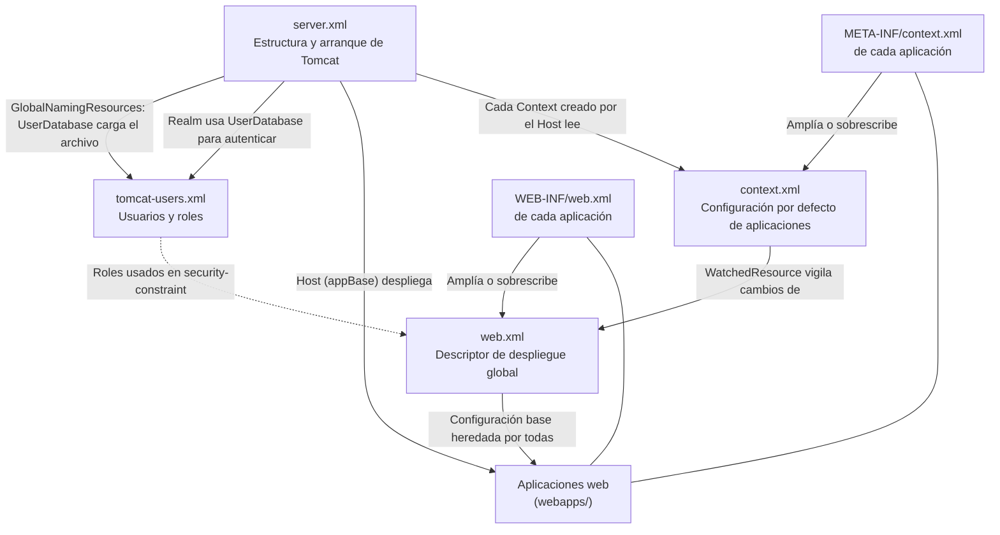

# Tomcat: Identificación de Archivos de Configuración
 
**Autora:** Miruna Georgiana Matei (Miuu)  
**Sistema Operativo:** Ubuntu 24.04 LTS  
**Servicio:** Apache Tomcat 10.1 (paquete `tomcat10`)  
 
---
 
## 1. Localización de los archivos clave
 
En una instalación con `apt`, la configuración de Tomcat está en `/etc/tomcat10/` (`CATALINA_BASE/conf` es un enlace a esa carpeta). Los cuatro archivos pedidos se localizan así:
 
```bash
# Listar el directorio de configuración
ls -l /etc/tomcat10/
 
# Comprobar que CATALINA_BASE/conf apunta a /etc/tomcat10
ls -ld /var/lib/tomcat10/conf
 
# Localizar cada archivo en el sistema
sudo find / -name server.xml -path "*tomcat*" 2>/dev/null
sudo find / -name web.xml -path "*tomcat10*" -not -path "*webapps*" 2>/dev/null
sudo find / -name tomcat-users.xml 2>/dev/null
sudo find / -name context.xml -path "*tomcat10*" 2>/dev/null
```
 
> 📸 **[CAPTURA 1 AQUÍ]:** Captura de la terminal con la salida de `ls -l /etc/tomcat10/` mostrando los cuatro archivos.
 
> 📸 **[CAPTURA 2 AQUÍ]:** Captura de la terminal con la salida de los comandos `find`.
 
| Archivo | Ruta en Ubuntu (instalación con `apt`) | Ruta en instalación manual |
| :--- | :--- | :--- |
| `server.xml` | `/etc/tomcat10/server.xml` | `/opt/tomcat/conf/server.xml` |
| `web.xml` | `/etc/tomcat10/web.xml` | `/opt/tomcat/conf/web.xml` |
| `tomcat-users.xml` | `/etc/tomcat10/tomcat-users.xml` | `/opt/tomcat/conf/tomcat-users.xml` |
| `context.xml` | `/etc/tomcat10/context.xml` | `/opt/tomcat/conf/context.xml` |
 
Para ver el contenido de cualquiera de ellos:
 
```bash
sudo cat /etc/tomcat10/server.xml
sudo less /etc/tomcat10/web.xml
```
 
> 📸 **[CAPTURA 3 AQUÍ]:** Captura de la terminal mostrando el contenido de cada uno de los cuatro archivos (o de las partes más relevantes).
 
---
 
## 2. Función de cada archivo y elementos configurables
 
### 2.1. `server.xml`: configuración principal del servidor
 
Es el archivo más importante. Define la **estructura completa de Tomcat** (servidor, servicios, conectores, motor y hosts) y se lee una sola vez, al arrancar. Cualquier cambio exige reiniciar el servicio.
 
Jerarquía de elementos principales:
 
```xml
<Server port="8005" shutdown="SHUTDOWN">
  <Listener ... />
  <GlobalNamingResources>
    <Resource name="UserDatabase" ... pathname="conf/tomcat-users.xml" />
  </GlobalNamingResources>
 
  <Service name="Catalina">
    <Connector port="8080" protocol="HTTP/1.1" ... />
    <Engine name="Catalina" defaultHost="localhost">
      <Realm className="org.apache.catalina.realm.LockOutRealm">
        <Realm className="org.apache.catalina.realm.UserDatabaseRealm"
               resourceName="UserDatabase"/>
      </Realm>
      <Host name="localhost" appBase="webapps"
            unpackWARs="true" autoDeploy="true">
        <Valve className="org.apache.catalina.valves.AccessLogValve" ... />
      </Host>
    </Engine>
  </Service>
</Server>
```
 
| Elemento | Qué se configura |
| :--- | :--- |
| `<Server>` | Instancia completa de Tomcat; puerto de apagado (`8005`) y palabra de apagado. |
| `<Listener>` | Componentes que reaccionan a eventos del ciclo de vida (por ejemplo, carga de APR/SSL o prevención de fugas de memoria). |
| `<GlobalNamingResources>` | Recursos JNDI globales, como la base de datos de usuarios `UserDatabase`. |
| `<Service>` | Agrupa uno o varios conectores con un único motor. |
| `<Connector>` | Puertos y protocolos de entrada (**Coyote**): HTTP en `8080`, HTTPS, AJP, tamaño de hilos, timeouts, etc. |
| `<Engine>` | Motor de procesamiento (**Catalina**); define el host por defecto. |
| `<Realm>` | Mecanismo de autenticación y autorización (de dónde salen usuarios y roles). |
| `<Host>` | Host virtual: nombre, directorio de aplicaciones (`appBase`), desempaquetado de `.war` y despliegue automático. |
| `<Valve>` | Componentes que interceptan peticiones, como el registro de accesos (`AccessLogValve`). |
 
### 2.2. `web.xml`: descriptor de despliegue global
 
Es el **descriptor de despliegue por defecto** (*Deployment Descriptor*). Contiene la configuración que se aplica a **todas las aplicaciones web** desplegadas en el servidor. Cada aplicación puede ampliarla o sobrescribirla con su propio `WEB-INF/web.xml`.
 
| Elemento | Qué se configura |
| :--- | :--- |
| `<servlet>` y `<servlet-mapping>` | Servlets predeterminados y las URL que atienden. Incluye `default` (archivos estáticos) y `jsp` (motor **Jasper**, para `*.jsp`). |
| `<filter>` y `<filter-mapping>` | Filtros aplicados a las peticiones. |
| `<session-config>` | Tiempo de expiración de las sesiones (`session-timeout`, 30 min por defecto). |
| `<mime-mapping>` | Asociación entre extensiones de archivo y tipos MIME. |
| `<welcome-file-list>` | Archivos que se sirven al acceder a un directorio (`index.html`, `index.htm`, `index.jsp`). |
| `<error-page>` | Páginas personalizadas de error. |
| `<security-constraint>`, `<login-config>`, `<security-role>` | Restricciones de acceso, método de autenticación y roles. |
 
### 2.3. `tomcat-users.xml`: usuarios y roles
 
Es la **base de datos de usuarios** de Tomcat, usada por defecto por el `UserDatabaseRealm`. Se emplea sobre todo para proteger el acceso a las aplicaciones de administración.
 
```xml
<tomcat-users>
  <role rolename="manager-gui"/>
  <role rolename="admin-gui"/>
  <user username="admin" password="********" roles="manager-gui,admin-gui"/>
</tomcat-users>
```
 
| Elemento | Qué se configura |
| :--- | :--- |
| `<role>` | Define un rol (`rolename`). |
| `<user>` | Define un usuario con su `username`, `password` y la lista de `roles`. |
 
Roles habituales: `manager-gui` (interfaz web de Manager), `manager-script` (acceso por scripts/API de texto), `manager-jmx`, `manager-status` y `admin-gui` (interfaz web de Host Manager).
 
### 2.4. `context.xml`: configuración por defecto de las aplicaciones
 
Define la configuración de **contexto** que se aplica a **todas las aplicaciones**. Un contexto (`<Context>`) representa una aplicación web concreta. Puede sobrescribirse para una aplicación con su propio `META-INF/context.xml`.
 
| Elemento | Qué se configura |
| :--- | :--- |
| `<Context>` | Propiedades generales del contexto (por ejemplo, recarga automática o uso de cookies). |
| `<WatchedResource>` | Archivos vigilados; si cambian (como `WEB-INF/web.xml`), la aplicación se recarga. |
| `<Resource>` | Recursos JNDI, por ejemplo un *pool* de conexiones a una base de datos. |
| `<Manager>` | Gestión y persistencia de las sesiones. |
| `<Valve>` | Filtros de acceso, como `RemoteAddrValve`, que restringe por IP el acceso a Manager y Host Manager (solo `localhost` por defecto). |
 
---
 
## 3. Mapa visual de dependencias
 
### 3.1. Diagrama de relaciones
 

 
### 3.2. Explicación de las dependencias
 
| Origen | Destino | Relación |
| :--- | :--- | :--- |
| `server.xml` | `tomcat-users.xml` | `GlobalNamingResources` define el recurso `UserDatabase` con `pathname="conf/tomcat-users.xml"`, y el `Realm` lo utiliza para autenticar. Sin esta conexión, los usuarios del archivo no tendrían efecto. |
| `server.xml` | Aplicaciones | El elemento `Host` indica con `appBase` la carpeta `webapps` de la que se despliegan. |
| `server.xml` | `context.xml` | Cada `Context` que crea el `Host` aplica la configuración de `conf/context.xml`. |
| `context.xml` | `web.xml` | Sus `WatchedResource` vigilan `conf/web.xml`: si cambia, las aplicaciones se recargan. |
| `web.xml` | Aplicaciones | Es la configuración base heredada por todas las aplicaciones, que pueden ampliarla con su propio `WEB-INF/web.xml`. |
| `tomcat-users.xml` | `web.xml` | Los roles definidos en `tomcat-users.xml` son los que se exigen en los `security-constraint` (por ejemplo, el de Manager). Los nombres de rol deben coincidir. |
 
**Resumen del orden de lectura:** al arrancar, Tomcat lee primero `server.xml`, que carga `tomcat-users.xml` a través del `UserDatabase`. Después, por cada aplicación, aplica `context.xml` y `web.xml` globales y, por último, los archivos propios de la aplicación.
 
---
 
## 4. Conclusiones
 
* **`server.xml`** es el eje de la configuración: define cómo se estructura Tomcat y de él dependen los demás archivos.
* **`tomcat-users.xml`** solo tiene efecto porque `server.xml` lo carga como recurso `UserDatabase`.
* **`web.xml` y `context.xml`** funcionan como configuración global por defecto; cada aplicación puede sobrescribirlas con las suyas propias.
* En Ubuntu, la instalación con `apt` coloca todos los archivos en `/etc/tomcat10/`, y los cambios en `server.xml` y `tomcat-users.xml` requieren reiniciar el servicio (`sudo systemctl restart tomcat10`).
 
